# 음악 서비스 DB 실습 리포트

**B6-1 · 정보를 깔끔하게 정리하는 디지털 서랍장 만들기**

설명 준비 바로가기: [항목 1. 구현과 증빙](#mission-1) &nbsp;· &nbsp;[항목 2. 설계 이유](#mission-2) · &nbsp;
[항목 3. 핵심 개념](#mission-3) ·&nbsp; [항목 4. 복잡한 쿼리와 문제 해결](#mission-4)

## 1. 주제와 실행 환경

음악 서비스의 회원, 아티스트, 앨범, 곡, 곡별 참여 크레딧, 재생 기록을 관리하는
관계형 데이터베이스를 설계했다. 로컬 PostgreSQL 18과 pgAdmin 4를 사용했다.
백엔드 프레임워크, 뷰, 프로시저, 트리거는 사용하지 않았다.

회원과 청취 행동은 가상 데이터이며, 곡은 음원 서비스에서 확인한 실제 수록곡을
앨범별 2개씩 선택했다. 앨범의 전체 수록곡이나 모든 제작 크레딧을 담지는 않았다.
아티스트 국적/데뷔년도는 학습 로그 값이며 별도 전수 검증은 완료하지 않았다.

## 2. 제출 파일과 실행 순서

| 파일                       | 내용                                  |
| -------------------------- | ------------------------------------- |
| [schema.sql](schema.sql)   | 최종 테이블 6개와 PK·FK·제약조건      |
| [seed.sql](seed.sql)       | 부모부터 입력하는 기본 샘플 데이터    |
| [queries.sql](queries.sql) | 필수 쿼리 15개와 변경 결과 확인       |
| [bonus.sql](bonus.sql)     | 두 풀이 비교, FK 오류 실험, 지표 조회 |
| [results/](results/)       | 실제 실행 결과 이미지와 ERD           |

빈 DB에서 `schema.sql → seed.sql → queries.sql` 순서로 실행한다.
`bonus.sql`은 절별로 실행하며 B02의 오류 확인 뒤 같은 탭에서 `ROLLBACK`한다.
`BEGIN`과 `COMMIT`은 트랜잭션 시작과 확정 문법으로 프로시저가 아니다.
생성·입력 파일은 빈 DB에서 한 번만 실행한다.

기존 `music_db`에서 실습한 결과를 캡처했으며, 별도 `music_verify`에서
테이블 생성·기본 입력 행 수, 쿼리 실행, 닉네임 변경, 삭제 후 11건,
인덱스 생성을 사용자가 확인했다. 캡처는 실습 시점의 실제 결과이므로
자동 생성 ID와 데이터 상태가 새 DB의 결과와 다를 수 있다.

## 3. ERD와 관계 설계

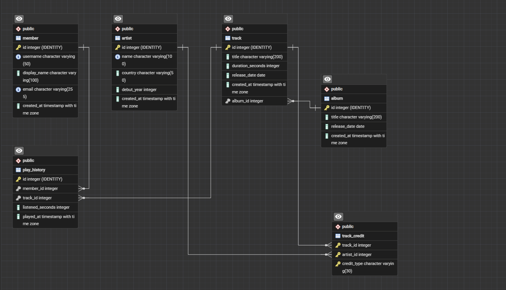

[ERD 이미지 원본](results/music_db_erd.png) · [pgAdmin 편집 파일](results/music_db_erd.pgerd)

| 부모   | 자식         | 관계 | 연결 컬럼                          |
| ------ | ------------ | ---- | ---------------------------------- |
| album  | track        | 1:N  | track.album_id → album.id          |
| member | play_history | 1:N  | play_history.member_id → member.id |
| track  | play_history | 1:N  | play_history.track_id → track.id   |
| track  | track_credit | 1:N  | track_credit.track_id → track.id   |
| artist | track_credit | 1:N  | track_credit.artist_id → artist.id |

곡과 아티스트의 N:M 관계는 `track_credit`을 통해 표현한다.
`artist`는 음악 참여자 정보, `credit_type`은 해당 곡에서의 역할이다.
`(track_id, artist_id, credit_type)` 복합 PK로 같은 곡에서 같은 사람의
역할 중복을 막으면서 가창·작곡 등 여러 역할을 허용한다.
현재 샘플 크레딧에는 PERFORMER 역할만 입력했다.

재생 기록 한 행은 한 번의 재생이다. 반복 재생은 새 행으로 기록한다.
청취 시간은 곡 길이 이하로 작성했지만 이 상한은 현재 DB 제약으로 강제하지 않는다.

## 4. 스키마 SQL

원본: [schema.sql](schema.sql). 테이블마다 PK를 두고 5개 FK로 연결했다.
NOT NULL, UNIQUE, CHECK를 사용하며 부모 테이블부터 생성한다.

<details>
<summary>전체 테이블 생성 SQL 보기</summary>

```sql
-- 음악 서비스 DB / PostgreSQL 18
-- 새 빈 DB에서 실행. 기존 music_db에 다시 실행하지 않는다.
-- 순서: schema.sql -> seed.sql -> queries.sql -> bonus.sql
-- PostgreSQL 자료형: TIMESTAMPTZ (시간대가 있는 시점).
-- 관계: album 1:N track, member 1:N play_history, track 1:N play_history
-- track과 artist는 track_credit을 통해 N:M 연결한다.

BEGIN;
CREATE TABLE member (
	id INTEGER GENERATED ALWAYS AS IDENTITY PRIMARY KEY, -- id 자동 부여
	username VARCHAR(50) NOT NULL UNIQUE,
	display_name VARCHAR(100) NOT NULL,
	email VARCHAR(255) NOT NULL UNIQUE,
	created_at TIMESTAMPTZ NOT NULL DEFAULT CURRENT_TIMESTAMP -- 생략 시 현재 시점을 저장; 표시 시간대는 세션 설정에 따름
);

CREATE TABLE artist (
	id INTEGER GENERATED ALWAYS AS IDENTITY PRIMARY KEY,
	name VARCHAR(100) NOT NULL UNIQUE,
	country VARCHAR(50),
	debut_year INTEGER,
	created_at TIMESTAMPTZ NOT NULL DEFAULT CURRENT_TIMESTAMP
);

CREATE TABLE album (
	id INTEGER GENERATED ALWAYS AS IDENTITY PRIMARY KEY,
	title VARCHAR(200) NOT NULL,
	release_date DATE,
	created_at TIMESTAMPTZ NOT NULL DEFAULT CURRENT_TIMESTAMP
);

CREATE TABLE track (
    id INTEGER GENERATED ALWAYS AS IDENTITY PRIMARY KEY,
    album_id INTEGER NOT NULL,
    title VARCHAR(200) NOT NULL,
    duration_seconds INTEGER NOT NULL CHECK (duration_seconds > 0),
    release_date DATE,
    created_at TIMESTAMPTZ NOT NULL DEFAULT CURRENT_TIMESTAMP,
    CONSTRAINT fk_track_album
        FOREIGN KEY (album_id) REFERENCES album(id)
);

CREATE TABLE track_credit (
	track_id INTEGER NOT NULL,
	artist_id INTEGER NOT NULL,
	credit_type VARCHAR(30) NOT NULL,

	PRIMARY KEY (track_id, artist_id, credit_type),

	CONSTRAINT fk_track_credit_track
		FOREIGN KEY (track_id)
		REFERENCES track(id),

	CONSTRAINT fk_track_credit_artist
		FOREIGN KEY (artist_id)
		REFERENCES artist(id),

	CONSTRAINT ck_track_credit_type
		CHECK (credit_type IN (
			'PERFORMER',
			'FEATURED',
			'SONGWRITER',
			'COMPOSER',
			'PRODUCER',
			'MIXER'
		))
);

CREATE TABLE play_history (
	id INTEGER GENERATED ALWAYS AS IDENTITY PRIMARY KEY,
	member_id INTEGER NOT NULL,
	track_id INTEGER NOT NULL,
	listened_seconds INTEGER NOT NULL CHECK (listened_seconds >= 0),
	played_at TIMESTAMPTZ NOT NULL DEFAULT CURRENT_TIMESTAMP,

	CONSTRAINT fk_play_history_member
		FOREIGN KEY (member_id)
		REFERENCES member(id),

	CONSTRAINT fk_play_history_track
		FOREIGN KEY (track_id)
		REFERENCES track(id)
);
COMMIT;
```

</details>

## 5. 샘플 데이터 SQL

원본: [seed.sql](seed.sql). ID를 고정하지 않고 이름·앨범·곡으로 찾아 FK를 연결한다.
회원 아이디는 `minxu01`로 통일했다. 공동 EP의 ooes도 아티스트와 크레딧에 포함했다.

| 시점               | 회원 | 아티스트 | 앨범 |  곡 | 크레딧 | 재생 기록 |
| ------------------ | ---: | -------: | ---: | --: | -----: | --------: |
| 기본 입력 직후     |   10 |       12 |   11 |  22 |     24 |        12 |
| Q14 삭제 직후      |   10 |       12 |   11 |  22 |     24 |        11 |
| 보너스 6건 추가 후 |   10 |       12 |   11 |  22 |     24 |        17 |

기본 입력과 Q14 후 행 수는 music_verify에서 확인했다.
보너스 결과는 기존 music_db의 17건 기준 캡처이다.

<details>
<summary>전체 샘플 데이터 SQL 보기</summary>

```sql
-- 샘플 데이터 입력 파일
-- 회원과 청취 행동은 가상 데이터. 실제 수록곡을 앨범별 2개씩 선택했다.
-- 곡 발매일은 등록한 앨범 버전의 발매일이다.
-- 아티스트 국적/데뷔년도는 워크로그 값을 옮겼으며 미확인 값은 NULL로 둔다.
-- PostgreSQL 전용: ::TIMESTAMPTZ (시간 자료형 변환).
-- 기대 행 수: 회원 10, 아티스트 12, 앨범 11, 곡 22, 크레딧 24, 재생 기록 12.
BEGIN;
INSERT INTO member (username, display_name, email)
VALUES
	('minxu01', '민수', 'minsu01@example.com'),
	('jiyoon02', '지윤', 'jiyoon02@example.com'),
    ('dohyuk03', '도혁', 'dohyuk03@example.com'),
    ('seoyeon04', '서연', 'seoyeon04@example.com'),
    ('junho05', '준호', 'junho05@example.com'),
    ('eunji06', '은지', 'eunji06@example.com'),
    ('taeyang07', '태양', 'taeyang07@example.com'),
    ('hanna08', '한나', 'hanna08@example.com'),
    ('woojin09', '우진', 'woojin09@example.com'),
    ('sora10', '소라', 'sora10@example.com');

INSERT INTO artist (name, country, debut_year)
VALUES
    ('데이먼스 이어', '대한민국', NULL),
    ('ADÉLA', '슬로바키아', 2024),
    ('PANTERA BLUE', '스페인', 2023),
    ('Arctic Monkeys', '영국', 2005),
    ('미야오', '대한민국', 2024),
    ('올데이프로젝트', '대한민국', 2025),
    ('Joji', '일본/호주', 2017),
    ('제니', '대한민국', 2018),
    ('오존', '대한민국', NULL),
    ('카더가든', '대한민국', 2013),
    ('유라', '대한민국', 2018);

INSERT INTO artist (name) VALUES ('ooes');

INSERT INTO album (title, release_date)
VALUES
    ('CORPUS 0', '2025-05-25'),
    ('PRIMA', '2026-09-04'),
    ('la nostalgia lleva mi nombre', '2025-05-23'),
    ('The Car', '2022-10-21'),
    ('BITE NOW', '2026-06-01'),
    ('CRASH', '2026-09-28'),
    ('Piss In The Wind', '2026-02-06'),
    ('Fallen Angel', '2026-08-28'),
    ('나는 지금 / 내 맘 같지 않던 그 시절', '2025-12-04'),
    ('Blue Heart', '2025-12-16'),
    ('Brush', '2026-07-09');

INSERT INTO track (
    album_id,
    title,
    duration_seconds,
    release_date
)
SELECT
    a.id,
    v.track_title,
    v.duration_seconds,
    a.release_date
FROM (
    VALUES
        ('CORPUS 0', '+', 217),
        ('CORPUS 0', '504 GATEWAY TIMEOUT', 136),

        ('PRIMA', 'KGB', 158),
        ('PRIMA', 'Ain''t In LA', 184),

        ('la nostalgia lleva mi nombre', 'suelo pensar muy mal', 146),
        ('la nostalgia lleva mi nombre', 'ojos', 155),

        ('The Car', 'There''d Better Be A Mirrorball', 265),
        ('The Car', 'Body Paint', 290),

        ('BITE NOW', 'Hit ''Em', 168),
        ('BITE NOW', 'DDI RO RI', 196),

        ('CRASH', 'TALK', 170),
        ('CRASH', 'CRASH', 173),

        ('Piss In The Wind', 'PIXELATED KISSES', 110),
        ('Piss In The Wind', 'Cigarette', 110),

        ('Fallen Angel', 'FALLEN ANGEL', 199),
        ('Fallen Angel', 'HEAVEN', 187),

        ('나는 지금 / 내 맘 같지 않던 그 시절', '나는 지금', 247),
        ('나는 지금 / 내 맘 같지 않던 그 시절', '내 맘 같지 않던 그 시절', 239),

        ('Blue Heart', 'LOVERS', 194),
        ('Blue Heart', '귤피차', 226),

        ('Brush', '고삐', 136),
        ('Brush', '누군가 먼저 뜬 자리', 186)
) AS v(album_title, track_title, duration_seconds)
JOIN album AS a
    ON a.title = v.album_title;

INSERT INTO track_credit (
    track_id,
    artist_id,
    credit_type
)
SELECT
    t.id,
    ar.id,
    'PERFORMER'
FROM (
    VALUES
        ('CORPUS 0', '데이먼스 이어'),
        ('PRIMA', 'ADÉLA'),
        ('la nostalgia lleva mi nombre', 'PANTERA BLUE'),
        ('la nostalgia lleva mi nombre', 'ooes'),
        ('The Car', 'Arctic Monkeys'),
        ('BITE NOW', '미야오'),
        ('CRASH', '올데이프로젝트'),
        ('Piss In The Wind', 'Joji'),
        ('Fallen Angel', '제니'),
        ('나는 지금 / 내 맘 같지 않던 그 시절', '오존'),
        ('Blue Heart', '카더가든'),
        ('Brush', '유라')
) AS v(album_title, artist_name)
JOIN album AS a
    ON a.title = v.album_title
JOIN track AS t
    ON t.album_id = a.id
JOIN artist AS ar
    ON ar.name = v.artist_name;

INSERT INTO play_history (
    member_id,
    track_id,
    listened_seconds,
    played_at
)
SELECT
    m.id,
    t.id,
    v.listened_seconds,
    v.played_at::TIMESTAMPTZ
FROM (
    VALUES
        ('minxu01', 'PRIMA', 'KGB',
         158, '2026-10-10 09:00:00+09'),

        ('minxu01', 'PRIMA', 'KGB',
         80, '2026-10-10 12:00:00+09'),

        ('jiyoon02', 'The Car', 'Body Paint',
         290, '2026-10-10 09:10:00+09'),

        ('dohyuk03', 'CORPUS 0', '+',
         217, '2026-10-10 10:00:00+09'),

        ('seoyeon04', 'BITE NOW', 'DDI RO RI',
         100, '2026-10-10 10:30:00+09'),

        ('junho05', 'CRASH', 'TALK',
         170, '2026-10-10 11:00:00+09'),

        ('eunji06', 'Piss In The Wind', 'Cigarette',
         110, '2026-10-10 11:30:00+09'),

        ('taeyang07', 'Fallen Angel', 'FALLEN ANGEL',
         199, '2026-10-11 08:00:00+09'),

        ('hanna08', '나는 지금 / 내 맘 같지 않던 그 시절', '나는 지금',
         120, '2026-10-11 09:00:00+09'),

        ('woojin09', 'Blue Heart', 'LOVERS',
         194, '2026-10-11 10:00:00+09'),

        ('sora10', 'Brush', '고삐',
         136, '2026-10-11 11:00:00+09'),

        ('jiyoon02', 'la nostalgia lleva mi nombre', 'ojos',
         155, '2026-10-11 12:00:00+09')
) AS v(
    username,
    album_title,
    track_title,
    listened_seconds,
    played_at
)
JOIN member AS m
    ON m.username = v.username
JOIN album AS a
    ON a.title = v.album_title
JOIN track AS t
    ON t.album_id = a.id
   AND t.title = v.track_title;
COMMIT;


SELECT 'member' AS table_name, COUNT(*) AS row_count FROM member
UNION ALL SELECT 'artist', COUNT(*) FROM artist
UNION ALL SELECT 'album', COUNT(*) FROM album
UNION ALL SELECT 'track', COUNT(*) FROM track
UNION ALL SELECT 'track_credit', COUNT(*) FROM track_credit
UNION ALL SELECT 'play_history', COUNT(*) FROM play_history;
```

</details>

## 6. 핵심 SQL 15개와 실행 결과

원본: [queries.sql](queries.sql).
Q01~Q04는 기본 조회, Q05~Q08은 조인, Q09~Q11은 집계,
Q12는 서브쿼리, Q13~Q14는 수정·삭제, Q15는 인덱스이다.
최종 SQL에는 동률 정렬 기준을 추가해 결과 순서를 일정하게 했다.

### Q01. 180초 이상인 곡을 긴 순으로 최대 5개 조회한다.

```sql
SELECT title, duration_seconds
FROM track
WHERE duration_seconds >= 180
ORDER BY duration_seconds DESC, id
LIMIT 5;
```

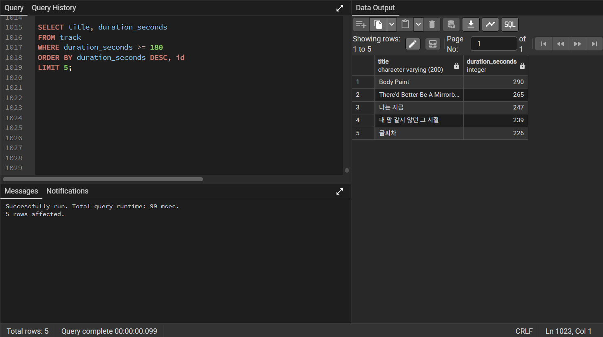

### Q02. 2026년에 발매된 앨범을 최신순으로 조회한다.

```sql
SELECT title, release_date
FROM album
WHERE release_date >= DATE '2026-01-01'
  AND release_date < DATE '2027-01-01'
ORDER BY release_date DESC, id;
```

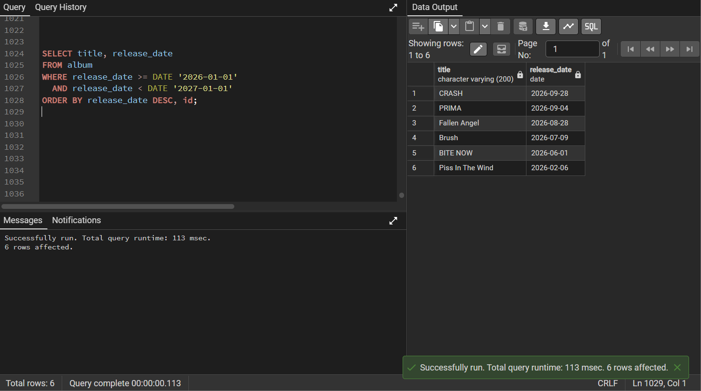

### Q03. 제목에 In이 포함된 곡을 대소문자 구분 없이 조회한다. PostgreSQL 전용: ILIKE.

```sql
SELECT title, duration_seconds
FROM track
WHERE title ILIKE '%In%'
ORDER BY id;
```

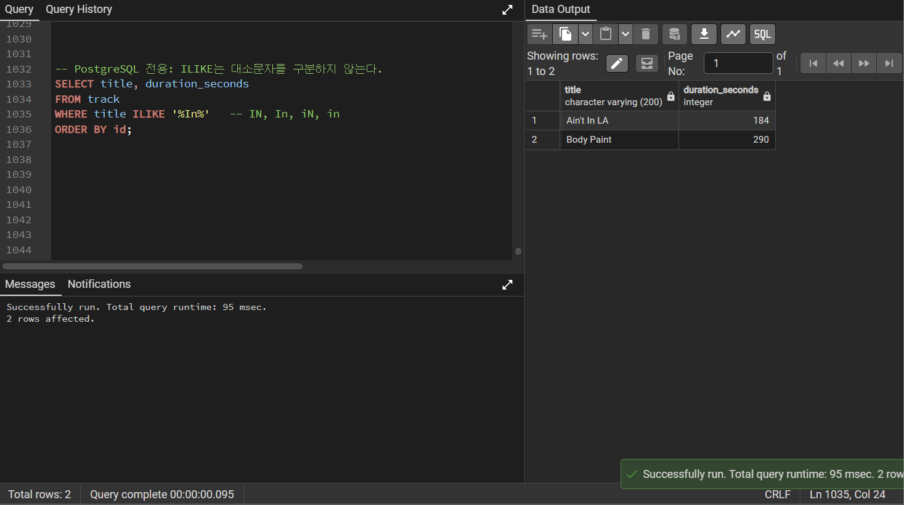

### Q04. 길이가 120초 미만이거나 240초 이상인 곡을 짧은 순으로 조회한다.

```sql
SELECT title, duration_seconds
FROM track
WHERE duration_seconds < 120 OR duration_seconds >= 240
ORDER BY duration_seconds ASC, id;
```

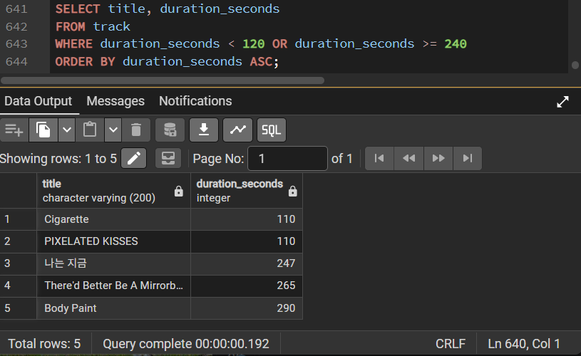

### Q05. 곡과 해당 앨범 제목을 INNER JOIN으로 조회한다.

```sql
SELECT t.title AS track_title, a.title AS album_title
FROM track AS t
INNER JOIN album AS a ON t.album_id = a.id
ORDER BY t.id;
```

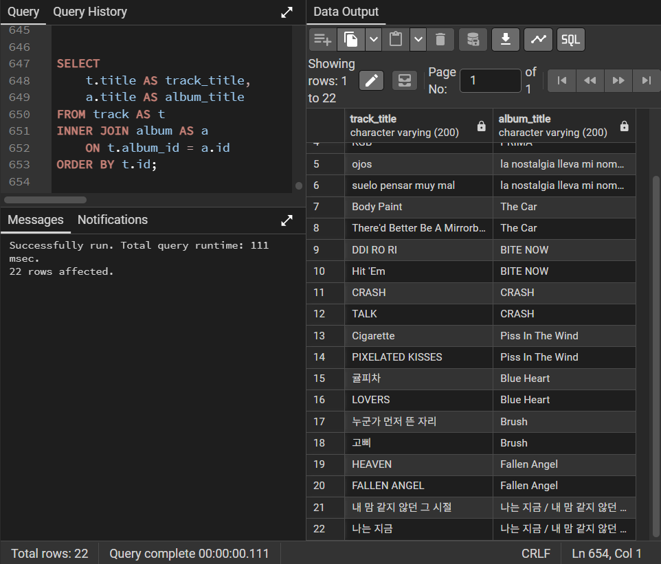

### Q06. 각 재생 기록의 회원 닉네임과 재생 시각을 조회한다.

```sql
SELECT m.display_name AS member_name, ph.played_at
FROM play_history AS ph
INNER JOIN member AS m ON m.id = ph.member_id
ORDER BY ph.played_at, ph.id;
```

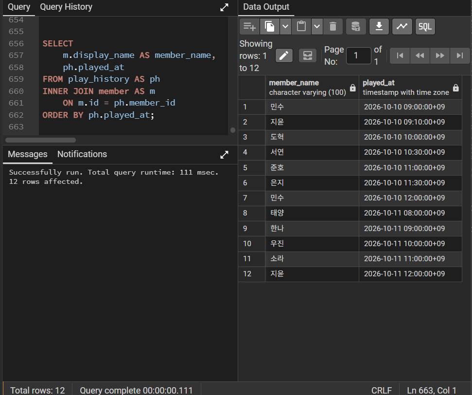

### Q07. 재생 기록이 없는 곡도 포함해 모든 곡과 재생 시각을 조회한다.

```sql
SELECT t.title AS track_title, ph.played_at
FROM track AS t
LEFT JOIN play_history AS ph ON t.id = ph.track_id
ORDER BY t.id, ph.played_at, ph.id;
```

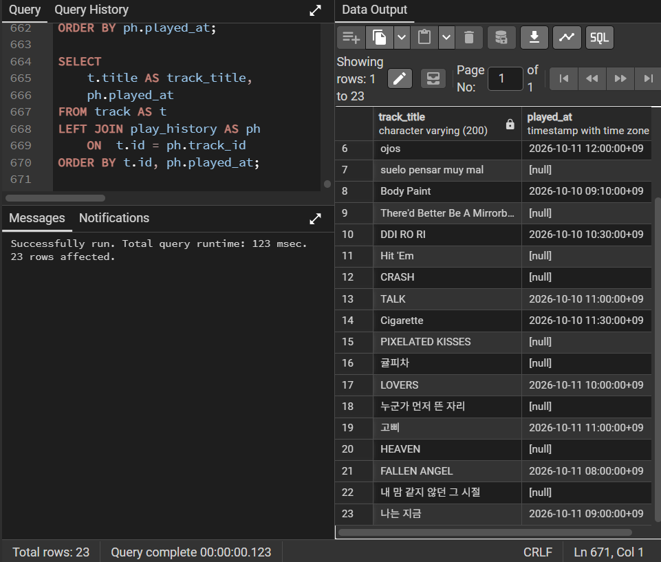

### Q08. 곡 제목, 참여 가수, 참여 역할을 세 테이블을 연결해 조회한다.

```sql
SELECT t.title AS track_title, ar.name AS artist_name, tc.credit_type
FROM track_credit AS tc
INNER JOIN track AS t ON tc.track_id = t.id
INNER JOIN artist AS ar ON tc.artist_id = ar.id
ORDER BY t.id, ar.name;
```

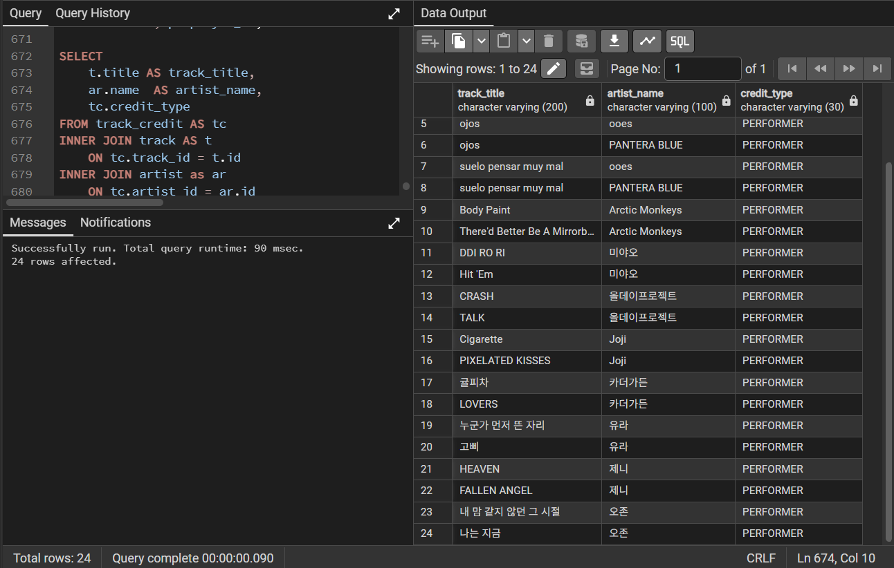

### Q09. 앨범별로 DB에 등록된 곡 수를 센다. 실제 전체 수록곡 수와 다르다.

```sql
SELECT a.id, a.title AS album_title, COUNT(t.id) AS track_count
FROM album AS a
LEFT JOIN track AS t ON a.id = t.album_id
GROUP BY a.id, a.title
ORDER BY a.id;
```

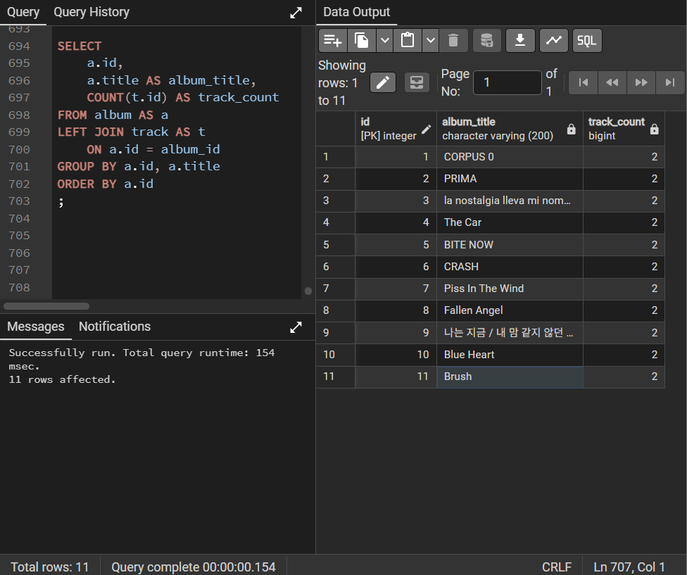

### Q10. 재생 기록이 있는 회원별 총 청취 시간을 초 단위로 집계한다.

```sql
SELECT m.id, m.display_name AS member_name,
       SUM(ph.listened_seconds) AS total_listened_seconds
FROM member AS m
INNER JOIN play_history AS ph ON m.id = ph.member_id
GROUP BY m.id, m.display_name
ORDER BY total_listened_seconds DESC, m.id;
```

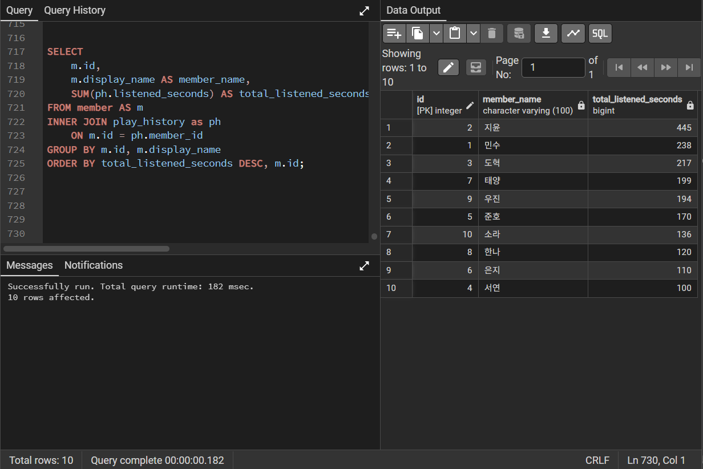

### Q11. 앨범별 등록 곡의 평균 길이를 소수점 둘째 자리까지 구한다.

```sql
SELECT a.id, a.title AS album_title,
       ROUND(AVG(t.duration_seconds), 2) AS avg_duration_seconds
FROM album AS a
INNER JOIN track AS t ON a.id = t.album_id
GROUP BY a.id, a.title
ORDER BY avg_duration_seconds DESC, a.id;
```

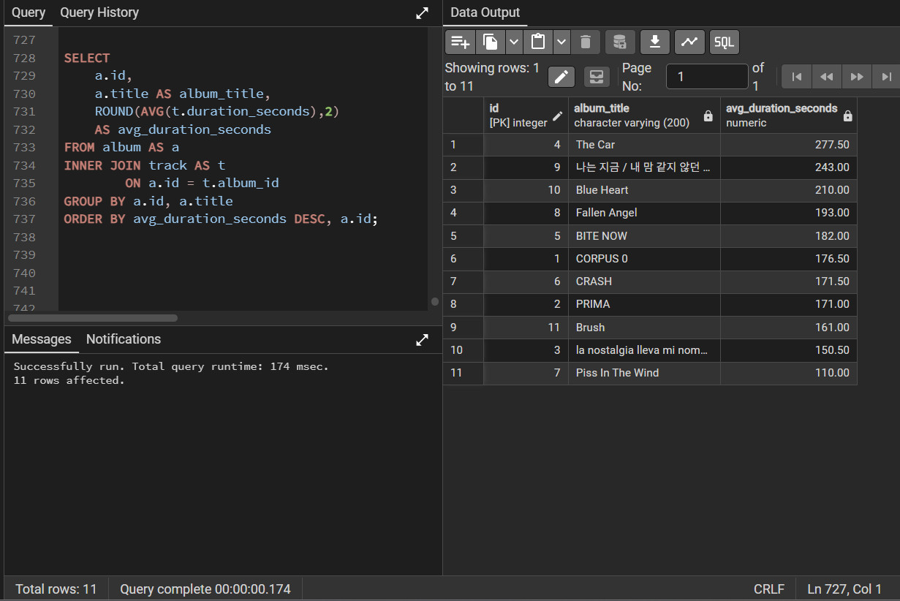

### Q12. 전체 곡의 평균 길이보다 긴 곡을 서브쿼리로 조회한다.

```sql
SELECT title, duration_seconds
FROM track
WHERE duration_seconds > (SELECT AVG(duration_seconds) FROM track)
ORDER BY duration_seconds DESC, id;
```

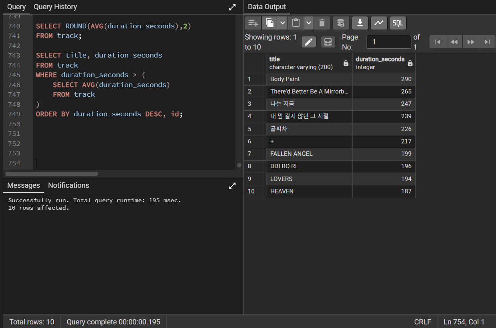

### Q13. minxu01 회원의 닉네임 변경 (전후 확인).

```sql
SELECT id, username, display_name FROM member WHERE username = 'minxu01';
UPDATE member
SET display_name = '음악듣는민수'
WHERE username = 'minxu01';
SELECT id, username, display_name FROM member WHERE username = 'minxu01';
```

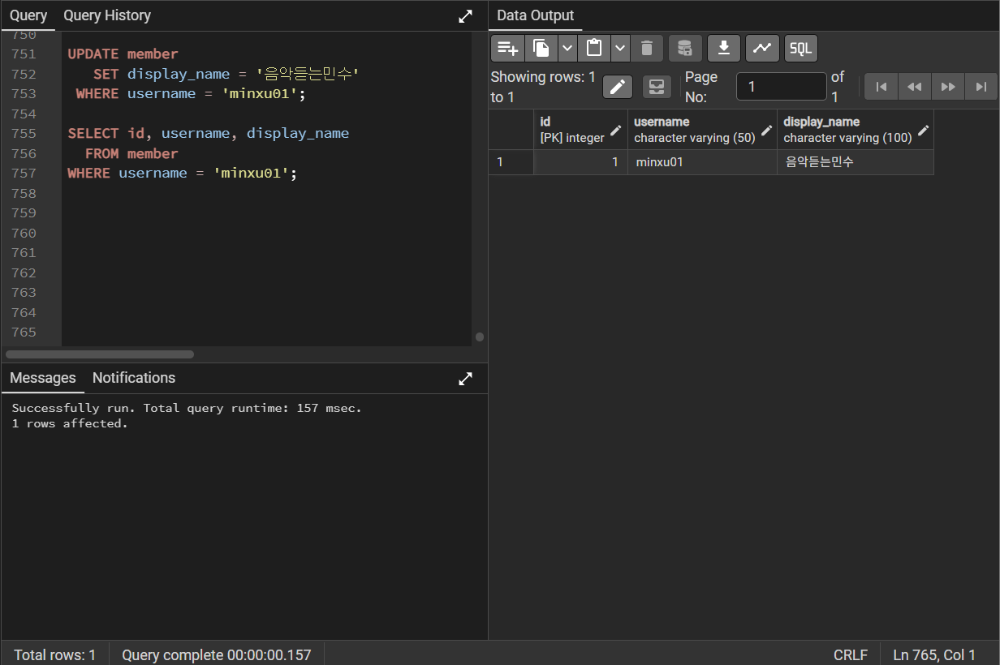

### Q14. minxu01의 KGB 80초 청취 기록 한 건을 삭제한다.

```sql
-- 워크로그의 id=12 대신 업무 조건으로 대상을 찾아 새 DB에서도 재현한다.
-- PostgreSQL 전용: DELETE USING, TIMESTAMPTZ 리터럴, RETURNING.
DELETE FROM play_history AS ph
USING member AS m, track AS t, album AS a
WHERE ph.member_id = m.id
  AND ph.track_id = t.id
  AND t.album_id = a.id
  AND m.username = 'minxu01'
  AND a.title = 'PRIMA'
  AND t.title = 'KGB'
  AND ph.listened_seconds = 80
  AND ph.played_at = TIMESTAMPTZ '2026-10-10 12:00:00+09'
RETURNING ph.*;
SELECT COUNT(*) AS history_count FROM play_history; -- 12 -> 11
```

캡처는 실습 당시 대상 ID 12를 확인하고 삭제한 결과다.
최종 SQL은 같은 회원·곡·시각·청취 시간으로 대상을 찾아 새 DB에서도 재현한다.

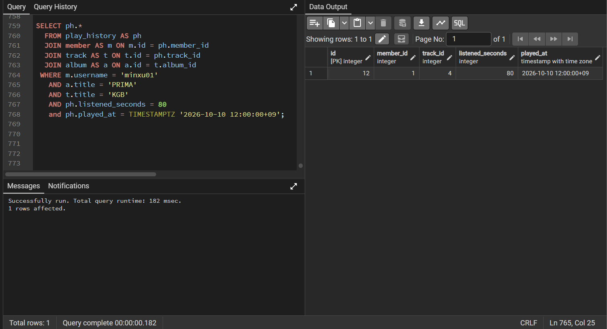

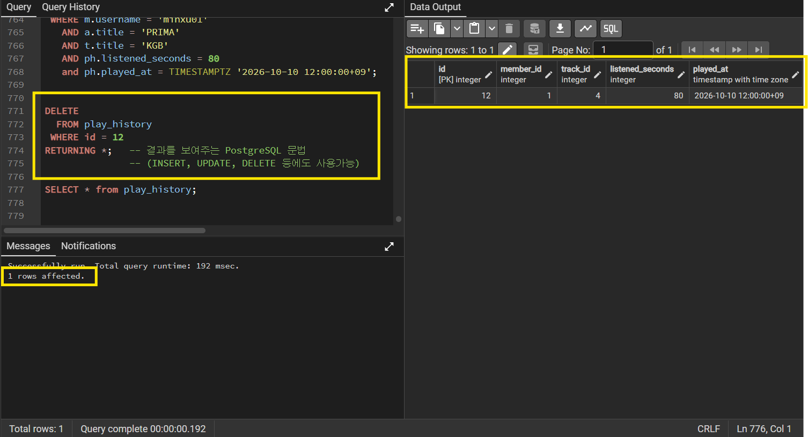

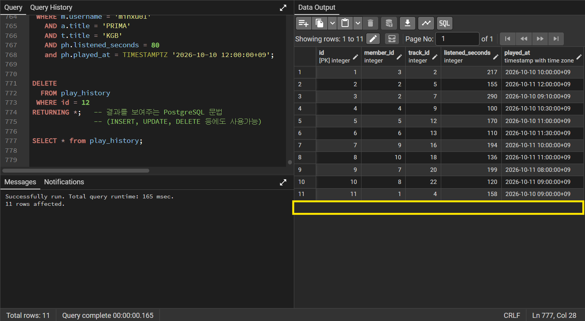

### Q15. 회원별 최신 재생 기록 검색과 정렬을 돕기 위한 복합 인덱스 생성.

```sql
CREATE INDEX idx_play_history_member_played_at
ON play_history (member_id, played_at DESC);
-- PostgreSQL 시스템 뷰로 생성 여부 확인.
SELECT indexname, indexdef
FROM pg_indexes
WHERE schemaname = 'public'
  AND tablename = 'play_history'
  AND indexname = 'idx_play_history_member_played_at';
```

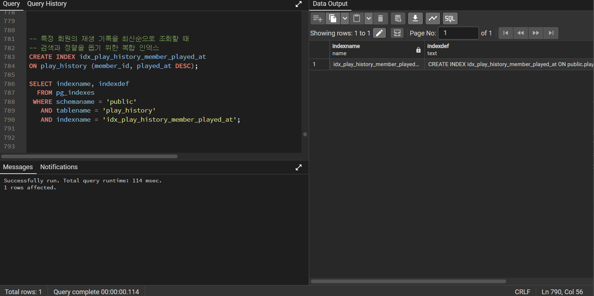

## 7. 보너스: 같은 요구를 두 방식으로 해결

한 번이라도 재생된 곡 목록을 JOIN과 IN 서브쿼리로 구했다.
JOIN은 연결 후 DISTINCT로 중복을 제거하고, IN은 ID 포함 여부를 판단한다.
실행 시 두 목록이 같음을 확인했다.

### JOIN 방식

```sql
SELECT DISTINCT t.id, t.title
FROM track AS t
INNER JOIN play_history AS ph ON ph.track_id = t.id
ORDER BY t.id;
```

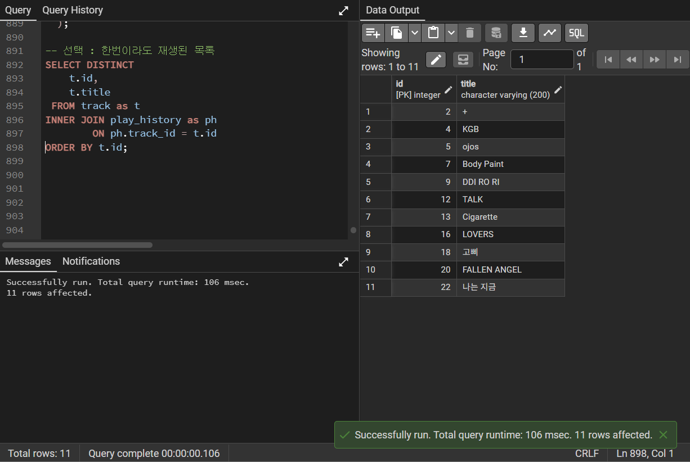

### 서브쿼리 방식

```sql
SELECT t.id, t.title
FROM track AS t
WHERE t.id IN (SELECT ph.track_id FROM play_history AS ph)
ORDER BY t.id;
-- JOIN은 연결 결과의 중복을 DISTINCT로 제거한다.
-- IN은 ID 포함 여부를 판단하므로 바깥 track 행을 중복 생성하지 않는다.
```

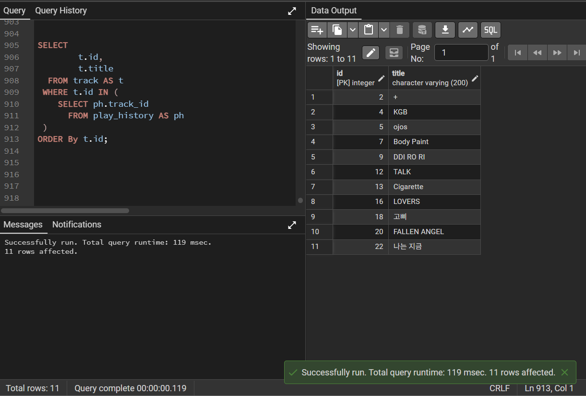

## 8. 보너스: FK 오류 실험

존재하는 회원을 선택하고 존재하지 않는 곡 ID -1을 참조했다.
MIN(id)는 회원 FK가 아니라 곡 FK 때문에 실패하도록 실제 회원 하나를 고르는 용도다.

```sql
BEGIN;
INSERT INTO play_history (member_id, track_id, listened_seconds)
VALUES ((SELECT MIN(id) FROM member), -1, 30);
ROLLBACK;
-- 원인: track에 -1이 없다. 해결: 실제 존재하는 track.id를 사용한다.
```

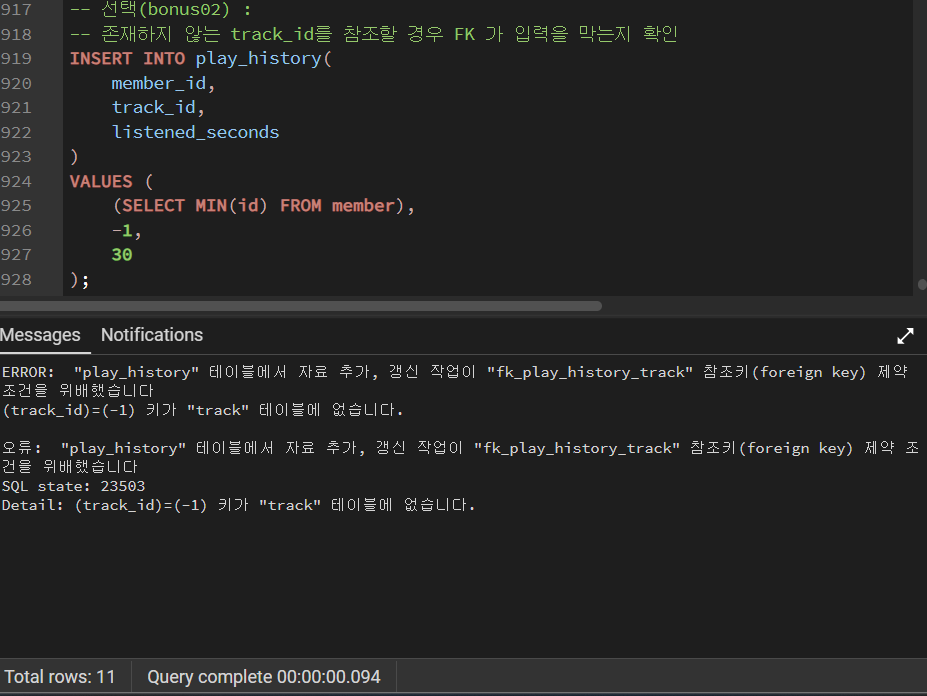

FK가 존재하지 않는 곡 참조를 막았다. 해결하려면 실제 존재하는 track.id를 사용해야 한다.

## 9. 보너스: 핵심 지표 3개

Q14 후 11건에 반복 청취 6건을 더한 가상 기록 17건 기준이다.
추가 입력 SQL은 [bonus.sql](bonus.sql)의 B03 준비 절에 있다.
아래 수치는 실제 결과 캡처와 대조했다.

### 9.1. 가장 많이 재생된 곡 TOP 5

```sql
SELECT t.id, t.title, COUNT(*) AS play_count
FROM play_history AS ph
JOIN track AS t ON t.id = ph.track_id
GROUP BY t.id, t.title
ORDER BY play_count DESC, t.id
LIMIT 5;
```

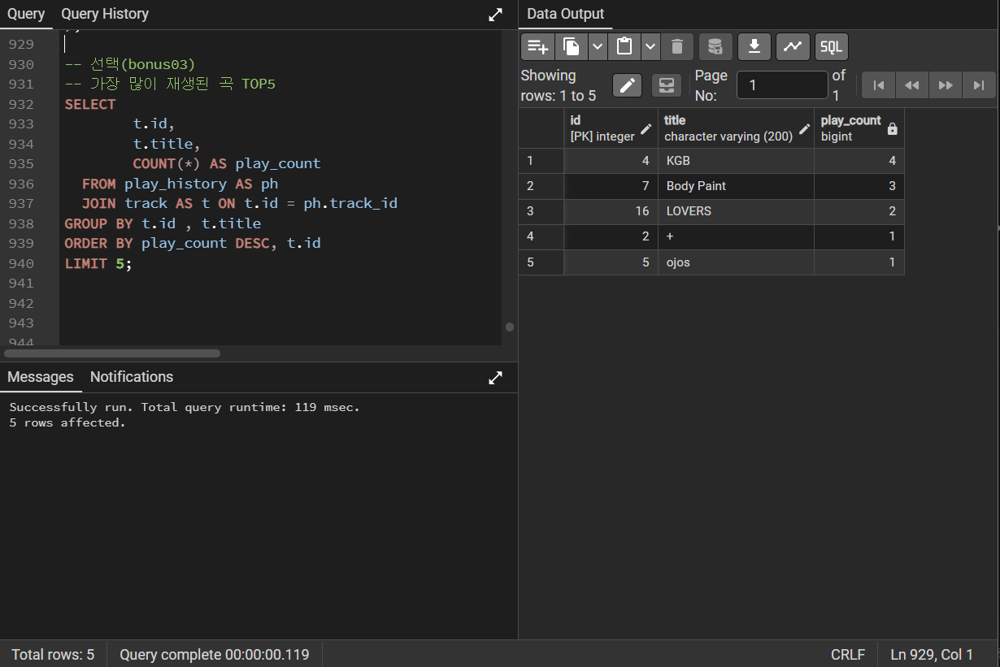

| 곡         | 재생 횟수 |
| ---------- | --------: |
| KGB        |         4 |
| Body Paint |         3 |
| LOVERS     |         2 |
| +          |         1 |
| ojos       |         1 |

KGB가 전체 17회 중 4회(약 23.53%)로 가장 많이 재생되었다.
동률은 곡 ID로 정렬한다. 가상 청취를 설계한 결과이므로 실제 이용자의 선호는 아니다.

### 9.2. 회원별 총 청취 시간

```sql
SELECT m.id, m.display_name,
       ROUND(SUM(ph.listened_seconds) / 60.0, 2) AS total_minutes
FROM play_history AS ph
JOIN member AS m ON m.id = ph.member_id
GROUP BY m.id, m.display_name
ORDER BY total_minutes DESC, m.id;
```

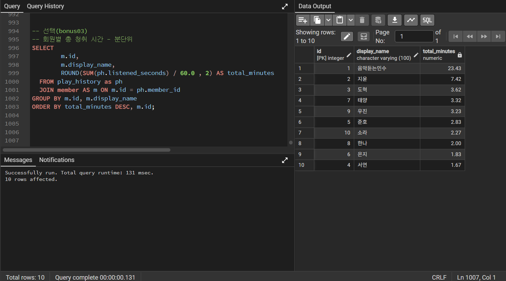

음악듣는민수는 23.43분, 지윤은 7.42분이었다.
각각 1,406초와 445초를 분으로 환산한 값과 일치한다.
재생 횟수뿐 아니라 곡 길이와 실제 청취 시간이 합계에 영향을 준다.
INNER JOIN이므로 재생 기록이 없는 회원은 제외한다.

### 9.3. 날짜별·곡별 재생 횟수

```sql
SELECT t.title,
       (ph.played_at AT TIME ZONE 'Asia/Seoul')::DATE AS play_date,
       COUNT(*) AS play_count
FROM play_history AS ph
JOIN track AS t ON ph.track_id = t.id
GROUP BY t.id, t.title, (ph.played_at AT TIME ZONE 'Asia/Seoul')::DATE
ORDER BY play_date, t.id;
```

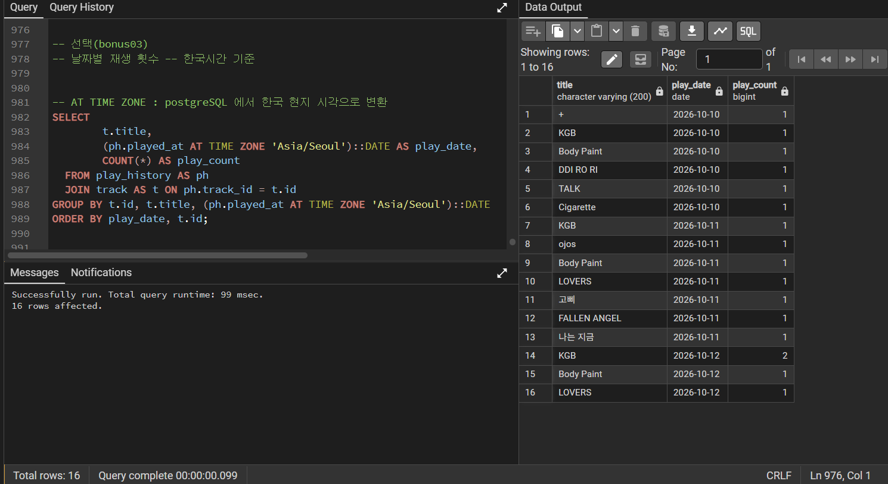

결과는 16개 날짜/곡 조합이며 10월 12일 KGB가 2회, 나머지는 각 1회였다.
결과를 날짜별로 합하면 10월 10일 6회, 11일 7회, 12일 4회로 총 17회다.
최다 재생일은 10월 11일이다.

날짜별 전체 합계만 구하는 보충 SQL:

```sql
SELECT (played_at AT TIME ZONE 'Asia/Seoul')::DATE AS play_date,
       COUNT(*) AS play_count
FROM play_history
GROUP BY (played_at AT TIME ZONE 'Asia/Seoul')::DATE
ORDER BY play_date;
```

## 10. 인덱스 실행 계획 실험

회원별 최신 20건 조회를 위해 `(member_id, played_at DESC)` 복합 인덱스를 만들었다.

```sql
EXPLAIN ANALYZE
SELECT *
FROM play_history
WHERE member_id = 1
ORDER BY played_at DESC
LIMIT 20;
```

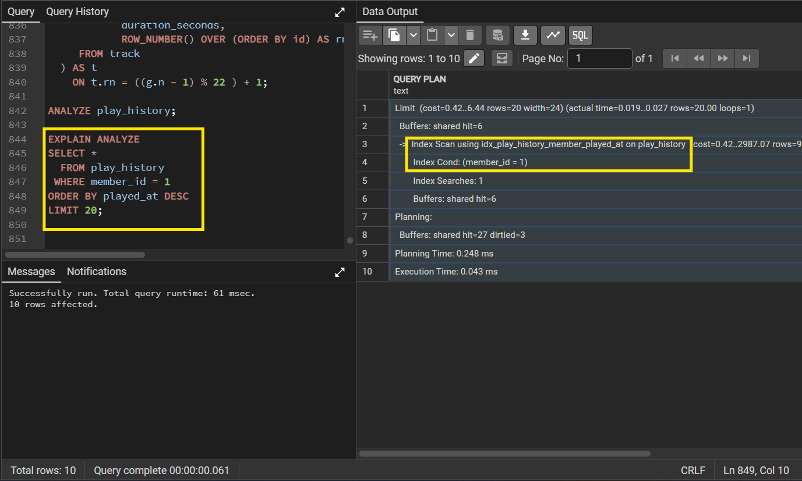

소량 데이터에서는 Seq Scan을 선택했으며 가상 기록 10만 건 추가 및
ANALYZE로 통계를 갱신한 후에는 해당 인덱스를 사용하는 Index Scan이 관찰되었다.
캡처의 Execution Time은 0.043ms였다. 실험용 10만 건은 삭제했으며 제출 seed에는 포함하지 않았다.

## 11. 수행 체크리스트와 설명 준비

<a id="mission-1"></a>

### 항목 1. 구현 조건과 실행 결과

| 확인사항                             | 구현 내용                                             | 확인할 자료                                               |
| ------------------------------------ | ----------------------------------------------------- | --------------------------------------------------------- |
| 최소 4개 테이블과 각 PK가 있는가?    | 6개 테이블. 5개는 id PK, track_credit은 3컬럼 복합 PK | [schema.sql](schema.sql), [ERD](results/music_db_erd.png) |
| FK를 사용한 1:N 관계가 최소 2개인가? | 앨범-곡 등 5개 FK 관계                                | ERD와 3절 관계 표                                         |
| 없는 값 참조가 실제로 막히는가?      | track_id=-1 입력 시 FK 오류                           | [FK 오류 결과](results/bonus_02_FK.png)                   |
| 테이블마다 최소 10행인가?            | 기본 입력 후 10 / 12 / 11 / 22 / 24 / 12행            | seed.sql 마지막 행 수 확인 쿼리, music_verify 확인 결과   |
| 기본 조회 4개인가?                   | Q01~Q04: 조건·정렬·개수 제한                          | queries.sql, results/01~04.png                            |
| 조인 4개인가?                        | Q05~Q08: INNER JOIN 3개, LEFT JOIN 1개                | queries.sql, results/05~08.png                            |
| 집계 3개인가?                        | Q09 COUNT, Q10 SUM, Q11 AVG와 GROUP BY                | queries.sql, results/09~11.png                            |
| 서브쿼리 1개인가?                    | Q12: 전체 평균보다 긴 곡 조회                         | [Q12 결과](results/12.png)                                |
| 수정·삭제 2개인가?                   | Q13 닉네임 변경, Q14 재생 기록 삭제                   | queries.sql 및 13·14번 캡처                               |
| 인덱스 1개와 생성 이유가 있는가?     | Q15: 회원별 최신 재생 기록용 복합 인덱스              | [생성 확인](results/15_create_index.png), 10절            |
| 각 쿼리 실행 결과가 첨부되었는가?    | 6절에 15개 SQL과 캡처를 연결                          | 이 문서 6절 및 results/                                   |

Q14로 한 행을 삭제한 뒤에도 재생 기록은 11행이므로 최소 10행 조건을 유지한다.
보너스 청취 기록 6건을 더한 실습 DB에서는 17행이다.
music_verify에서 필수 파일을 실행하고 데이터 수와 변경 결과를 확인했다.

<a id="mission-2"></a>

### 항목 2. 테이블·관계·자료형·인덱스의 설계 이유

#### 테이블을 왜 이렇게 나눴는가?

곡 정보와 재생 기록은 변경 이유와 저장 단위가 다르다.
곡 제목·길이는 한 번 저장하고, 누가 언제 얼마나 들었는지는 재생할 때마다 저장한다.
앨범·아티스트 정보도 별도로 두어 같은 정보를 여러 행에 반복 입력하는 것을 줄였다.

| 테이블       | 한 행의 의미                              | 분리한 이유                                      |
| ------------ | ----------------------------------------- | ------------------------------------------------ |
| member       | 회원 한 명                                | 닉네임·계정·이메일을 재생 기록마다 반복하지 않음 |
| artist       | 음악 참여자 한 명 또는 그룹 하나          | 여러 곡에 참여하는 동일한 사람·그룹을 ID로 연결  |
| album        | 발매물 하나                               | 앨범명·앨범 발매일을 곡마다 반복하지 않음        |
| track        | 특정 앨범 버전의 곡 하나                  | 곡 길이 등 곡 자체 정보와 청취 행동을 구분       |
| track_credit | 특정 곡에서 참여자 한 명이 맡은 역할 하나 | 공동 참여와 한 사람의 여러 역할을 표현           |
| play_history | 회원이 곡을 한 번 재생한 기록             | 같은 회원·곡의 반복 청취를 여러 행으로 보존      |

설명 예시:

> KGB를 100번 재생해도 track에는 곡 한 행만 둡니다.
> 대신 play_history에는 100개의 재생 행을 넣습니다.
> 제목을 수정할 때 track 한 곳을 수정하면 되고, 각 청취 기록은 그대로 남습니다.

#### 1:N 관계는 실제 도메인에서 무슨 의미인가?

> PRIMA 앨범 하나에 KGB와 Ain't In LA라는 여러 곡이 연결됩니다.
> track.album_id가 album.id를 참조하므로 각 곡이 어느 앨범에 속하는지 알 수 있습니다.
> 또 민수 한 명에게 여러 play_history가 연결되므로 반복 청취를 기록할 수 있습니다.

곡과 참여자는 N:M이다. 한 곡에 여러 참여자가 있고 한 참여자는 여러 곡에 참여한다.
이를 track_credit의 두 1:N 관계로 나눴다.
동일한 곡과 아티스트라도 PERFORMER와 COMPOSER는 서로 다른 크레딧 행으로 등록할 수 있다.
샘플에는 PERFORMER만 들어 있지만 CHECK가 허용한 다른 역할도 저장할 수 있다.

#### 컬럼 타입은 왜 그렇게 선택했는가?

| 타입과 컬럼 예시                            | 선택 이유                                               |
| ------------------------------------------- | ------------------------------------------------------- |
| INTEGER: id, member_id, track_id            | 정수 식별자와 참조를 저장하고 PK/FK 타입을 맞춤         |
| GENERATED ALWAYS AS IDENTITY                | PostgreSQL이 정수 ID를 생성하도록 지정                  |
| VARCHAR: title, name, username              | 문자열을 저장하고 과제에서 정한 최대 길이를 표현        |
| VARCHAR: credit_type + CHECK                | 역할 문자열을 저장하되 허용한 역할만 입력               |
| INTEGER: duration_seconds, listened_seconds | 초 단위 수치로 저장하여 비교·SUM·AVG 계산을 쉽게 함     |
| INTEGER: debut_year                         | 일자 없이 연도만 저장하는 선택 정보                     |
| DATE: release_date                          | 앨범 버전의 발매 날짜만 필요하므로 시간은 저장하지 않음 |
| TIMESTAMPTZ: played_at, created_at          | 시간대를 고려하는 재생·생성 시점을 저장                 |

제목에는 길이 상한을 정한 VARCHAR를 사용했다. 상한을 정할 필요가 없다면 PostgreSQL의
TEXT도 선택할 수 있다. VARCHAR가 항상 TEXT보다 빠르다는 이유로 선택한 것은 아니다.
TIMESTAMPTZ는 같은 시점을 세션 시간대에 맞춰 표시하며, 사용자의 해외 이동을 자동 감지하지 않는다.
country와 debut_year에는 모르는 값이 있을 수 있어 NULL을 허용했다.

#### 인덱스는 왜 그 컬럼과 순서인가?

```sql
CREATE INDEX idx_play_history_member_played_at
ON play_history (member_id, played_at DESC);
```

> 특정 회원의 최근 재생 기록을 찾는 조회를 기준으로 설계했습니다.
> 먼저 member_id가 같은 범위를 찾고, 그 안에서 played_at 최신순으로 20건을 읽도록
> member_id를 앞에 두고 played_at DESC를 뒤에 두었습니다.

인덱스는 모든 조회에서 강제로 사용되지 않는다. 플래너가 통계를 바탕으로 선택한다.
11행에서는 Seq Scan을 선택했고, 10만 건 추가 후에는 이 인덱스를 사용하는 것을 확인했다.
ANALYZE는 통계를 갱신하고, EXPLAIN ANALYZE는 조회를 실제 실행해 계획과 시간을 보여준다.
인덱스에는 추가 저장 공간과 INSERT·UPDATE·DELETE 시 유지 비용도 있다.

<a id="mission-3"></a>

### 항목 3. DB와 엑셀, 키, JOIN, GROUP BY 설명

#### DB가 엑셀과 어떻게 다른가?

엑셀도 여러 시트와 조회 함수를 통해 데이터를 연결할 수 있다.
이번 과제에서 강조한 관계형 DB의 차이는 단순한 데이터 양보다
키와 제약조건으로 관계를 관리하고, 여러 사용자의 변경을 트랜잭션으로 처리하며,
SQL로 필요한 데이터를 연결·집계하는 방식이다.

| 한 재생 목록에 모든 정보를 반복 저장하면                 | 이번 DB에서는                          |
| -------------------------------------------------------- | -------------------------------------- |
| 같은 회원의 닉네임을 여러 행에서 바꿔야 함               | member 한 곳을 변경하고 ID로 연결      |
| 같은 곡의 제목을 잘못 입력해 서로 다르게 남길 수 있음    | track의 곡을 FK로 참조                 |
| 존재하지 않는 곡을 청취 기록에 적을 수 있음              | FK가 없는 곡 ID 참조를 차단            |
| 같은 곡에 여러 참여자가 있을 때 한 셀에 목록을 넣기 쉬움 | track_credit에 참여자별·역할별 행 저장 |

#### PK와 FK는 무엇이 다른가?

> PK는 자기 테이블의 행을 고유하게 식별하는 키이고 중복과 NULL을 허용하지 않습니다.
> FK는 다른 행과의 연결이 유효한지 검사하는 키입니다.
> 예를 들어 album.id가 앨범 PK이고, track.album_id는 그 앨범을 참조하는 FK입니다.

같은 album_id가 여러 곡에 반복되는 것은 정상이며 1:N의 N을 표현한다.
FK 자체가 UNIQUE라는 뜻은 아니다. 또한 PostgreSQL에서는 FK 컬럼에
인덱스가 자동 생성되는 것은 아니므로 조회 목적에 따라 따로 검토한다.

#### INNER JOIN과 LEFT JOIN의 차이는?

곡과 재생 기록을 같은 방향으로 비교하면 차이를 설명하기 쉽다.

```sql
-- 연결되는 재생 기록이 있는 곡만 나타남
SELECT t.title, ph.played_at
FROM track AS t
INNER JOIN play_history AS ph ON ph.track_id = t.id;

-- 재생 기록이 없는 곡도 유지됨: Q07
SELECT t.title, ph.played_at
FROM track AS t
LEFT JOIN play_history AS ph ON ph.track_id = t.id;
```

> INNER JOIN은 ON 조건에 맞는 조합만 반환합니다.
> LEFT JOIN은 왼쪽 track을 모두 유지하고, 연결되는 재생 기록이 없으면
> 오른쪽 played_at을 NULL로 보여줍니다. Q07 캡처에서 그 NULL을 확인할 수 있습니다.

[Q07 결과 확인](results/07.png). 한 곡이 여러 번 재생되면 연결 결과에도 여러 행이 나온다.
LEFT JOIN 뒤에 `WHERE ph.id IS NULL`을 붙이면 한 번도 재생되지 않은 곡을 찾을 수 있다.

#### GROUP BY와 COUNT·SUM·AVG는 어떻게 동작하는가?

GROUP BY는 결과 행을 정한 기준별로 묶고, 집계 함수는 각 묶음을 계산한다.

| 쿼리 | 묶는 기준        | 계산                  | 결과 해석                  |
| ---- | ---------------- | --------------------- | -------------------------- |
| Q09  | 앨범 ID와 제목   | COUNT(t.id)           | 등록 곡이 앨범마다 2개     |
| Q10  | 회원 ID와 닉네임 | SUM(listened_seconds) | 회원별 실제 청취 초 합계   |
| Q11  | 앨범 ID와 제목   | AVG(duration_seconds) | 앨범별 등록 곡의 평균 길이 |

예를 들어 PRIMA의 158초, 184초 두 곡을 한 묶음으로 보면
COUNT는 2, 곡 길이 SUM은 342, AVG는 171초다.
Q11은 평균을 ROUND(..., 2)로 반올림해 표시하며 원본 길이를 변경하지 않는다.

Q09에서 COUNT(t.id)는 NULL을 세지 않으므로 곡이 없는 앨범은 0이다.
COUNT(\*)는 LEFT JOIN이 남긴 행도 세기 때문에 그 경우 1이 될 수 있다.
제목이 같은 앨범도 구분하도록 제목만이 아니라 ID도 GROUP BY에 포함했다.

Q10은 기본 12건 기준 민수의 158초와 80초를 합쳐 238초가 된다.
Q14 삭제와 보너스 입력 후에는 데이터가 달라져 지표의 합계도 달라진다.
초기 집계 캡처와 보너스 결과를 같은 시점의 데이터로 혼동하지 않는다.

<a id="mission-4"></a>

### 항목 4. 복잡한 쿼리와 어려웠던 부분

#### 설명할 복잡한 쿼리: Q08의 세 테이블 JOIN

요구는 “곡 제목, 참여자 이름, 해당 곡에서 맡은 역할을 함께 보여주기”다.

```sql
SELECT t.title AS track_title,
       ar.name AS artist_name,
       tc.credit_type
FROM track_credit AS tc
INNER JOIN track AS t ON tc.track_id = t.id
INNER JOIN artist AS ar ON tc.artist_id = ar.id
ORDER BY t.id, ar.name;
```

1. 필요한 정보의 위치를 찾았다. 제목은 track, 이름은 artist, 역할은 track_credit에 있다.
2. 연결의 중심인 track_credit에서 출발했다. 한 행은 곡·참여자·역할의 조합이다.
3. tc.track_id = t.id로 곡을 연결해 제목을 가져왔다.
4. tc.artist_id = ar.id로 참여자를 연결해 이름을 가져왔다.
5. 필요한 세 컬럼을 선택하고 곡 ID와 참여자 이름 순으로 정렬했다.
6. [Q08 결과](results/08.png)에서 곡 22개에 크레딧 24개가 표시되는 이유를 확인했다.

공동 EP의 두 곡에 PANTERA BLUE와 ooes가 각각 연결되어 크레딧이 두 행씩 나온다.
따라서 JOIN 결과가 곡 수보다 많아도 오류가 아니다.
SELECT DISTINCT로 무조건 줄이면 실제 여러 참여자 정보를 가릴 수 있다.

#### 추가 질문: INSERT 뒤에 왜 VALUES 대신 SELECT가 있는가?

샘플 입력에서는 VALUES로 임시 목록을 만들고, 실제 앨범·회원·곡과 JOIN해서 ID를 찾았다.
INSERT ... SELECT는 이 조회 결과를 한 행씩 대상 테이블에 저장한다.
입력 대상 컬럼과 SELECT 컬럼은 이름이 아니라 나열한 위치 순서대로 대응한다.
이 방식은 일일히 나열하지 않아도 된다는 점과 INNER JOIN 불일치 시에 오류 없이 입력이 된다는 장점이 있지만, 수행후 입력 갯수를 확인해야한다.

#### 실제 어려움 1: 오류 없이 일부 데이터가 빠진 문제

| 상황                                                    | 원인                                                          | 해결                                                            | 배운 점                                            |
| ------------------------------------------------------- | ------------------------------------------------------------- | --------------------------------------------------------------- | -------------------------------------------------- |
| 재생 기록 12건을 준비했는데 10건만 저장됨               | 회원 username은 minxu01인데 임시 입력 목록에는 minsu01을 사용 | 실제 username을 확인하고 빠진 2건 입력, seed에서 minxu01로 통일 | INNER JOIN에 맞지 않는 행은 오류 없이 빠질 수 있음 |
| SQL 전체는 맞는데 첫 VALUES 행 끝에서 입력 끝 구문 오류 | pgAdmin에 전체 문장이 전달되지 않은 것으로 판단               | 새 탭에 SQL 한 문장 전체를 넣고 Ctrl+A 후 실행, 12건 확인       | 선택 범위와 실행된 행 수를 확인해야 함             |

> 가장 기억에 남는 문제는 INSERT가 성공했는데 두 건이 빠진 일이었습니다.
> 회원 목록을 확인하니 minxu01과 minsu01이 달랐고, INNER JOIN에서 두 행이 제외됐습니다.
> 이름을 맞추고 입력을 보충한 뒤 COUNT로 12건을 확인했습니다.
> 이후에는 오류 유무뿐 아니라 입력된 행 수와 누락 관계도 확인하게 됐습니다.

#### 실제 어려움 2: 인덱스를 만들었는데 사용하지 않는 문제

> 처음에는 인덱스를 만들면 조회마다 사용하는 줄 알았습니다.
> 하지만 적은 데이터에서는 Seq Scan이 선택됐습니다.
> 가상 재생 기록 10만 건을 넣고 ANALYZE로 통계를 갱신한 뒤 같은 조회를 실행하니
> Index Scan using idx_play_history_member_played_at이 나타났습니다.
> 인덱스는 플래너가 비용을 비교해 선택한다는 것을 실행 계획으로 확인했습니다.

실험에서 ROLLBACK 후에도 10만 건이 남은 상황이 있었다.
실제 트랜잭션 실행 범위를 다시 확인하고 실험 시각 범위로 대상을 확인한 뒤 삭제했다.
BEGIN이 실제 실행되고 확정되지 않은 트랜잭션의 변경만 ROLLBACK으로 취소할 수 있다.
